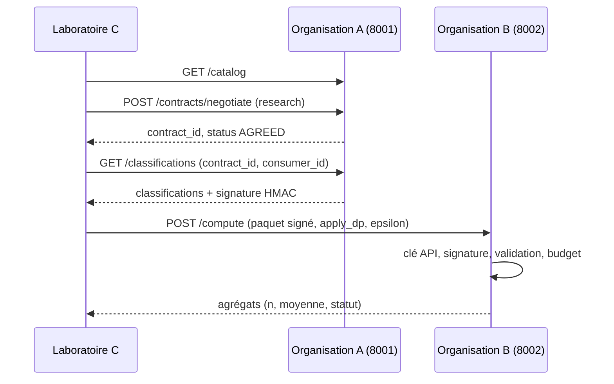

# Mini-espace de données fédéré — Santé et qualité de l'air

**Master IASD — Intelligence Artificielle et Sciences de Données**
**Module :** Data Spaces & Data Integration & Semantic Interoperability
**Travaux pratiques :** TP1 à TP4
**Contexte :** prototype d'un espace de données régional (Tanger, **données fictives**).

Ce projet implémente un espace de données fédéré qui permet à plusieurs organisations de mener une analyse conjointe de la qualité de l'air (PM2.5) et des admissions hospitalières, **sans centraliser leurs bases de données**.

Trois nœuds indépendants :

- **Organisation A — Environnement :** détient les mesures PM2.5 ; fournit un catalogue, négocie les contrats, émet des classifications signées et tient un journal d'audit. Les mesures brutes ne quittent jamais ce nœud en TP4 : seules des **catégories signées** circulent.
- **Organisation B — Hôpital :** détient les admissions ; vérifie la signature de A, calcule localement et ne renvoie que des agrégats protégés.
- **Laboratoire C — Université :** orchestre les échanges (client Python) ; n'ouvre jamais les bases SQLite.

---

## Architecture

| Nœud | Rôle | Port |
|---|---|---|
| Organisation A | Mesures PM2.5, catalogue, contrats, classifications signées (HMAC-SHA256), journal d'audit | 8001 |
| Organisation B | Admissions, calcul local, seuil minimal de publication, bruit de Laplace, budget de confidentialité | 8002 |
| Laboratoire C | Orchestration et analyse des agrégats, sans accès aux bases | — |

- A et B : API **FastAPI** + base **SQLite** locale.
- C : client Python (`requests`).
- Communication : HTTP/JSON.

### Flux du scénario TP4



1. C lit le catalogue de A : `GET /catalog`.
2. C demande un contrat : `POST /contracts/negotiate`. A contrôle, dans l'ordre : clé API (401) → dataset (404) → finalité `research` (403) → consommateur `laboratoire-iasd` (403).
3. C récupère les classifications signées : `GET /classifications`.
4. C transmet le paquet signé à B : `POST /compute`.
5. B contrôle, dans l'ordre : clé API (401) → signature HMAC (403) → contenu (400) → budget de confidentialité si bruit demandé (429), puis calcule et renvoie **uniquement des agrégats**.

---

## Arborescence

```text
mini-espace-federe/
├── organisation_A/
│   ├── config.py                    # clés, secret, finalité, seuil, chemins des bases
│   ├── database/
│   │   ├── setup_data.py            # environnement_tp1.db (5 j) / environnement.db (10 j)
│   │   └── consulter_environnement.py
│   ├── api/
│   │   ├── api_air_tp2.py           # TP2 : /mesures, /statistiques (brut, sans clé)
│   │   ├── api_air_v3.py            # TP3 : /categories (clé API)
│   │   └── api_air.py               # TP4 : catalogue, contrat, classifications signées, audit
│   ├── security/
│   │   ├── auth.py                  # clé API, comparaison en temps constant
│   │   └── signature.py             # signature / vérification HMAC-SHA256
│   └── verifier_A.py                # auto-vérification du nœud A (rejoue le scénario de C)
│
├── organisation_B/
│   ├── database/
│   │   ├── setup_hopital.py         # hopital_tp1.db (5 j) / hopital.db (10 j)
│   │   └── consulter_hopital.py
│   ├── api/
│   │   ├── api_hopital_tp2.py       # TP2 : /admissions, /statistiques (brut, sans clé)
│   │   ├── api_hopital_v3.py        # TP3 : POST /analyse-locale (clé API)
│   │   └── api_hopital.py           # TP4 : POST /compute
│   ├── services/
│   │   ├── calcul_local.py          # agrégats calculés près des données
│   │   └── confidentialite.py       # seuil minimal, bruit de Laplace, budget epsilon
│   └── security/
│       ├── auth.py                  # clé API (401)
│       └── signature.py             # vérification HMAC émise par A (403)
│
├── laboratoire_C/
│   ├── tp2_client.py
│   ├── tp3_laboratoire.py
│   ├── tp3_attaque_difference.py
│   └── client_analyse.py            # TP4
│
├── tests/
│   ├── test_organisation_A.py
│   ├── test_organisation_B.py
│   └── test_organisation_B_tp1_tp3.py
│
├── requirements.txt
├── pytest.ini
├── .gitignore
└── README.md
```

---

## Technologies

| Technologie | Utilisation |
|---|---|
| Python 3.10+ | Langage principal |
| SQLite (`sqlite3`) | Stockage local de chaque organisation |
| FastAPI | API REST |
| Uvicorn | Serveur d'exécution des API |
| Pydantic | Validation des requêtes |
| Requests | Appels HTTP du laboratoire C |
| `hmac` / `hashlib` | Signature HMAC-SHA256, comparaisons en temps constant |
| Pytest + HTTPX | Tests automatisés (`TestClient` de FastAPI) |

---

## Installation

Prérequis : Python 3.10 ou supérieur.

**Windows PowerShell**
```powershell
python -m venv .venv
.\.venv\Scripts\Activate.ps1
python -m pip install -r requirements.txt
```

**Linux / macOS**
```bash
python3 -m venv .venv
source .venv/bin/activate
python -m pip install -r requirements.txt
```

Toutes les commandes se lancent **depuis la racine du projet**, avec l'environnement virtuel activé.

---

## Configuration (variables d'environnement)

Les valeurs par défaut sont des valeurs de **démonstration** : à ne jamais utiliser en production.

| Variable | Valeur par défaut | Utilisée par | TP |
|---|---|---|---|
| `CLE_AIR` | `secret-air-key-demo` | A (clé API) et client C | 4 |
| `CLE_HOPITAL` | `secret-hospital-key-demo` (TP4) / `demo-hopital-456` (TP3) | B (clé API) et client C | 3-4 |
| `CLE_ENVIRONNEMENT` | `demo-air-123` | A, API TP3 | 3 |
| `SECRET_FEDERATION` | `secret-federation-demo` | A **et** B (signature HMAC) | 4 |
| `ENVIRONNEMENT_DB` | `organisation_A/database/environnement.db` | A (chemin de la base TP4) | 4 |
| `URL_AIR`, `URL_HOPITAL` | `http://127.0.0.1:8001` / `:8002` | client C | 2-4 |

Les clés du TP3 sont volontairement différentes de celles du TP4. Si vous avez défini `CLE_HOPITAL` pour le TP3, ouvrez un nouveau terminal (ou supprimez la variable) avant de lancer le TP4.

Paramètres métier (dans `organisation_A/config.py`) : dataset `dataset-air-tanger`, finalité autorisée `research`, consommateur autorisé `laboratoire-iasd`, seuil PM2.5 = 30 µg/m³ (seuil pédagogique, pas une référence réglementaire).

---

## Bases de données

| Jeu | Jours | Fichiers | Utilisation |
|---|---:|---|---|
| TP1-TP3 | 5 | `environnement_tp1.db`, `hopital_tp1.db` | Stockage, API ouvertes, calcul local |
| TP4 | 10 | `environnement.db`, `hopital.db` | Gouvernance, signatures, confidentialité |

Les deux jeux sont séparés pour ne pas s'écraser. Tables : `qualite_air(date, ville, pm25)` pour A et `admissions(date, ville, nombre)` pour B. Les scripts d'initialisation **réinitialisent** la table à chaque exécution.

```bash
# TP1-TP3 (5 jours)
python organisation_A/database/setup_data.py --jeu tp1
python organisation_B/database/setup_hopital.py --jeu tp1

# TP4 (10 jours, jeu par défaut)
python organisation_A/database/setup_data.py
python organisation_B/database/setup_hopital.py

# Consultation (affiche les deux bases si elles existent)
python organisation_A/database/consulter_environnement.py
python organisation_B/database/consulter_hopital.py
```

---

## TP1 — Stockage fédéré

Deux bases SQLite indépendantes, une par organisation (`qualite_air` chez A, `admissions` chez B). Aucune fusion dans un dépôt central. Les commandes de création et de consultation sont données ci-dessus.

## TP2 — API REST ouvertes

> Un seul TP à la fois : les API utilisent toujours les ports 8001 et 8002, et ne sont lancées **sans** `--reload`. Arrêtez les serveurs (Ctrl+C) avant de passer au TP suivant.

```bash
python -m uvicorn organisation_A.api.api_air_tp2:app --port 8001
python -m uvicorn organisation_B.api.api_hopital_tp2:app --port 8002
python laboratoire_C/tp2_client.py
```

- A : `GET /mesures`, `GET /statistiques`
- B : `GET /admissions`, `GET /statistiques`
- Swagger : http://127.0.0.1:8001/docs et http://127.0.0.1:8002/docs

Le client joint les données brutes par date et calcule les moyennes. **Attendu :** pollution élevée = **16,0** ; autres jours = **8,5**.

**Limite :** les données brutes des deux organisations sont transmises au laboratoire, sans authentification.

## TP3 — Contrôle d'accès et calcul local

PowerShell :
```powershell
$env:CLE_ENVIRONNEMENT="demo-air-123"; $env:CLE_HOPITAL="demo-hopital-456"
```
Linux / macOS : `export CLE_ENVIRONNEMENT=demo-air-123 CLE_HOPITAL=demo-hopital-456`

```bash
python -m uvicorn organisation_A.api.api_air_v3:app --port 8001
python -m uvicorn organisation_B.api.api_hopital_v3:app --port 8002
python laboratoire_C/tp3_laboratoire.py
python laboratoire_C/tp3_attaque_difference.py
```

- A : `GET /categories` (clé API) renvoie des catégories `elevee` / `non_elevee`, jamais le PM2.5 brut.
- B : `POST /analyse-locale` (clé API) associe les catégories à ses admissions et renvoie des moyennes par groupe.
- **Attendu :** 3 jours élevés → 16,0 ; 2 jours non élevés → 8,5 ; différence **7,5**.
- **Attaque par différence :** le laboratoire choisit lui-même un groupe d'un seul jour (`2026-10-01`) et obtient l'admission exacte : **8,0**.

**Limite :** une clé API et un calcul local ne protègent pas contre les attaques sur les agrégats ; le TP4 corrige ce point.

---

## TP4 — Gouvernance et confidentialité

### Endpoints

| Nœud | Endpoint | Protection | Rôle |
|---|---|---|---|
| A | `GET /` , `GET /health` | aucune | Identité, état, nombre de contrats actifs |
| A | `GET /catalog` | aucune | Catalogue (JSON inspiré de DCAT) |
| A | `POST /contracts/negotiate` | clé API | Négociation de contrat |
| A | `GET /classifications` | clé API + contrat | Classifications signées |
| A | `GET /audit` | clé API | Journal d'accès |
| B | `POST /compute` | clé API + signature | Calcul local d'agrégats |

### 1. Catalogue

`GET /catalog` décrit le dataset : identifiant, titre, description, éditeur, couverture temporelle (`2026-10-01/2026-10-10`), unité, endpoint d'accès et finalité autorisée. Structure **inspirée** de DCAT et d'ODRL, non conforme aux standards.

### 2. Négociation de contrat

Ordre des contrôles : clé API (401) → dataset (404) → finalité (403) → consommateur (403). Un contrat accepté reçoit un identifiant `contract-air-xxxxxxxx` et le statut `AGREED`. Les contrats sont **en mémoire**.

### 3. Classifications signées (HMAC-SHA256)

`GET /classifications` vérifie la clé, l'existence du contrat, son statut et son dataset, puis la finalité et le consommateur (403 en cas d'échec). A convertit chaque mesure en catégorie :

- `au_dessus_seuil` si PM2.5 > 30 µg/m³ ;
- `sous_seuil` sinon.

Chaque élément ne contient que `{date, categorie}` : **aucune valeur PM2.5**. La signature couvre `contract_id`, `consumer_id` et `classifications` : toute modification (sous-ensemble, catégorie changée, autre consommateur) invalide la signature.

### 4. Calcul local et protection des résultats (B)

Contrôles de `POST /compute`, dans l'ordre :

1. Clé API → 401.
2. Signature HMAC émise par A → 403.
3. Contenu : liste vide, dates dupliquées, catégorie inconnue, date absente de la base hospitalière → 400.
4. Budget de confidentialité (si `apply_dp=true`) → 429 s'il est épuisé.

**Seuil minimal de publication.** Un groupe de moins de 3 jours n'est pas publié : `{"n": ..., "moyenne": null, "statut": "SUPPRIME_GROUPE_TROP_PETIT"}` (réponse HTTP 200).

**Bruit de Laplace** (si `apply_dp=true`). Le bruit est ajouté à la moyenne du groupe, avec l'échelle :

$$b = \frac{30 / n}{\varepsilon}$$

où $n$ est le nombre de jours du groupe, $\varepsilon$ le paramètre de confidentialité et 30 la borne pédagogique d'admissions par jour. La moyenne bruitée est ensuite bornée à $[0, 30]$. Les effectifs $n$ ne sont pas bruités. L'aléa vient de `random.SystemRandom`.

**Budget de confidentialité.** Budget cumulé de **3,0 par contrat** ; chaque requête avec bruit consomme $\varepsilon$. Avec $\varepsilon = 1$, les 3 premiers appels passent et le **4e renvoie 429**. Le budget est suivi par `contract_id`.

### 5. Journal d'audit

Chaque événement (négociation, classifications, audit) est tracé avec horodatage UTC, statut HTTP et motif en cas de refus. Consultable via `GET /audit` (clé API requise). Le journal est en mémoire.

---

## Lancement complet — TP4

Trois terminaux, environnement virtuel activé, **sans `--reload`** (contrats, journal et budget sont en mémoire et seraient perdus).

**Terminal 1 — A**
```bash
python organisation_A/database/setup_data.py
python -m uvicorn organisation_A.api.api_air:app --port 8001
```
Swagger : http://127.0.0.1:8001/docs

**Terminal 2 — B**
```bash
python organisation_B/database/setup_hopital.py
python -m uvicorn organisation_B.api.api_hopital:app --port 8002
```
Swagger : http://127.0.0.1:8002/docs

**Terminal 3 — C**
```bash
python laboratoire_C/client_analyse.py                       # sans bruit
python laboratoire_C/client_analyse.py --bruit               # avec bruit de Laplace
python laboratoire_C/client_analyse.py --bruit --epsilon 1.0
```

Le client exécute : catalogue → tests négatifs (finalité commerciale → 403, dataset inconnu → 404, clé A incorrecte → 401) → contrat → classifications → calcul par B → tests négatifs côté B (classifications falsifiées → 403, clé B incorrecte → 401). Il affiche « attendu X, reçu Y » pour chaque test négatif.

> Un contrat n'ouvre que 3 appels avec bruit à $\varepsilon = 1$ ; chaque exécution du client négocie un nouveau contrat, donc un nouveau budget. Pour observer le 429, répétez `POST /compute` avec le même paquet (voir Swagger ou les tests).

---

## Contrat d'interface A ↔ B

- `SECRET_FEDERATION` **identique** des deux côtés (défaut : `secret-federation-demo`), sinon B répond 403.
- Message signé : JSON `{contract_id, consumer_id, classifications}` avec `sort_keys=True`, séparateurs `(",", ":")`, `ensure_ascii=False`, encodé en UTF-8 ; HMAC-SHA256 en hexadécimal.
- Catégories TP4 : `au_dessus_seuil` / `sous_seuil` (le TP3 utilise `elevee` / `non_elevee`).

---

## Tests et validation

```bash
python -m pytest tests -v
```

| Fichier | Tests | Couverture |
|---|---:|---|
| `test_organisation_A.py` | 15 | Catalogue, négociation, authentification, classifications signées, absence de PM2.5 brut, audit |
| `test_organisation_B.py` | 13 | Calcul sans bruit, signature, validation, seuil minimal, bruit borné et variable, budget |
| `test_organisation_B_tp1_tp3.py` | 9 | Base de 5 lignes, API TP2, contrôles TP3, attaque par différence |
| **Total** | **37** | |

Les tests de A utilisent une base temporaire ; les tests de B recréent `hopital.db` à chaque test. Les tests de B simulent A avec la même fonction de signature.

### Scénarios négatifs vérifiés

| Scénario | Code HTTP |
|---|---:|
| Clé API absente ou incorrecte | 401 |
| Dataset inconnu | 404 |
| Finalité non autorisée | 403 |
| Consommateur non autorisé / différent de celui du contrat | 403 |
| Contrat inconnu | 403 |
| Signature falsifiée (sous-ensemble ou catégorie modifiée) | 403 |
| Catégorie inconnue, dates dupliquées, liste vide, date absente de la base | 400 |
| Groupe inférieur au seuil minimal | 200 (groupe supprimé) |
| Budget de confidentialité épuisé (4e appel) | 429 |

### Auto-vérification du nœud A

Le script `organisation_A/verifier_A.py` rejoue ce que fera le laboratoire sur A (catalogue, négociation, refus 401/403/404, 10 classifications dont 5/5, absence de PM2.5, signature valide, signature invalide sur liste tronquée).

```bash
python -m uvicorn organisation_A.api.api_air:app --port 8001      # terminal 1
python -m organisation_A.verifier_A                               # terminal 2
```
Il affiche `NŒUD A PRÊT POUR LE LABORATOIRE` si tous les contrôles passent (clé par défaut `secret-air-key-demo`).

---

## Résultats obtenus — TP4

| Catégorie | Jours | Moyenne des admissions |
|---|---:|---:|
| Au-dessus du seuil (> 30 µg/m³) | 5 | 16,2 |
| Sous le seuil (≤ 30 µg/m³) | 5 | 7,8 |

$$\bar{x}_{\text{au-dessus}} = \frac{14+18+16+20+13}{5} = 16{,}2 \qquad
\bar{x}_{\text{sous}} = \frac{8+9+10+7+5}{5} = 7{,}8 \qquad
\Delta = 8{,}4$$

La différence est de **8,4 admissions par jour**. Avec le bruit activé, les moyennes varient d'une exécution à l'autre : c'est le compromis entre confidentialité et utilité. Sur ce petit jeu fictif, le résultat suggère une **association** ; il ne démontre **aucune causalité**.

---

## Limites

- Le seuil minimal de 3 jours n'est **pas** du k-anonymat.
- Le bruit de Laplace est une illustration, pas une implémentation complète de la confidentialité différentielle (composition simplifiée, bornes pédagogiques).
- Contrats, journal d'audit et budget sont **en mémoire** : perdus au redémarrage.
- Le bruit est demandé par le consommateur (`apply_dp`) et non imposé par le serveur.
- Le secret HMAC est partagé entre A et B : pas de non-répudiation.
- HTTP sans TLS ; clés et secret de démonstration.
- Données fictives, limitées à 10 jours.
- La fédération ne signifie pas qu'aucune information ne circule : classifications et agrégats sont échangés.
- Une clé API seule ne garantit pas la souveraineté des données.

## Améliorations possibles

- Persistance des contrats, budgets et journaux ; expiration et révocation des contrats.
- Signatures asymétriques (Ed25519) pour la non-répudiation.
- HTTPS/TLS.
- Catalogue conforme DCAT et politiques d'usage en ODRL.
- Comptabilité rigoureuse du budget et de la composition en confidentialité différentielle ; bruit imposé côté serveur.
- Jeux de données réels et plus volumineux, dans un cadre autorisé.

---

## Dépannage

| Symptôme | Cause probable |
|---|---|
| `ModuleNotFoundError: organisation_A` | Commande lancée hors de la racine du projet |
| `/compute` renvoie 403 | `SECRET_FEDERATION` différent entre A et B, ou paquet modifié |
| 401 sur A ou B | Clé API incorrecte ; variable `CLE_*` d'un TP précédent encore définie |
| Port 8001/8002 déjà utilisé | Serveur du TP précédent encore actif |
| 403 « Contrat inconnu » | A a redémarré (contrats en mémoire) : renégocier |
| Fichier `.db` verrouillé (Windows) | Serveur ou script encore ouvert ; arrêter avant de recréer la base |

---

## Références

- Support de travaux pratiques du Master IASD : *Mini-espace de données fédéré — Santé et qualité de l'air*, TP1 à TP4.
- [W3C — Data Catalog Vocabulary (DCAT) Version 2](https://www.w3.org/TR/vocab-dcat-2/)
- [W3C — ODRL Information Model 2.2](https://www.w3.org/TR/odrl-model/)
- [RFC 2104 — HMAC: Keyed-Hashing for Message Authentication](https://www.rfc-editor.org/rfc/rfc2104)
- [The Algorithmic Foundations of Differential Privacy](https://www.cis.upenn.edu/~aaroth/Papers/privacybook.pdf)
- [FastAPI](https://fastapi.tiangolo.com/) · [SQLite](https://www.sqlite.org/docs.html)
